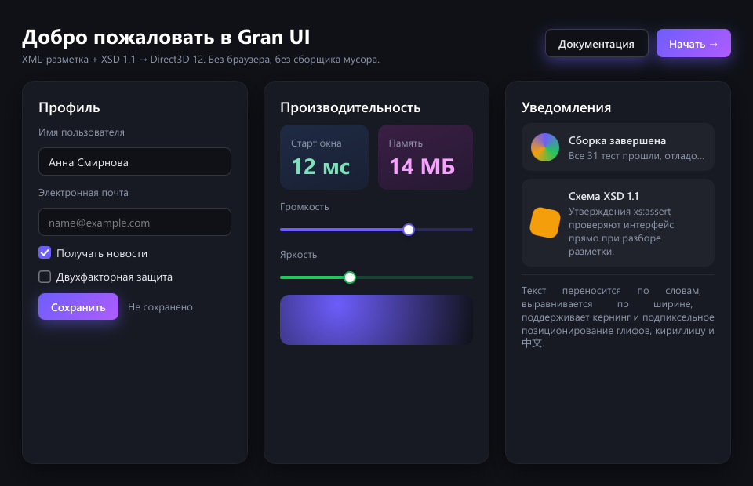
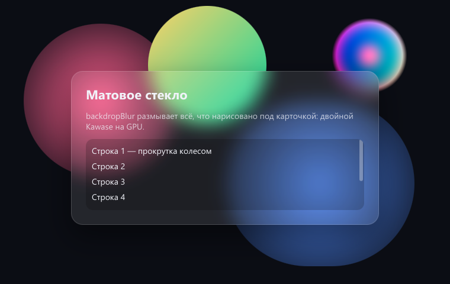

# Gran UI

[Русский](README.md) · **English**

**Gran UI** is a user interface engine written in **C++17**: the window is described using XML markup, styled with CSS-like syntax, and rendered directly onto the graphics card via **Direct3D 12**. The goal is to achieve the look and feel of HTML + CSS (gradients, shadows, rounded corners, frosted glass, smooth transitions) without a browser, without a garbage collector, and without third-party dependencies: startup in milliseconds and 0% CPU usage when idle.

The XML markup is parsed and validated by the XML library [Beresta](https://github.com/ErmaleyAlekov/beresta) by the same author: the XSD 1.1 schema is built into the engine, and any markup error is visible with the line, column, and path even before the window is created.

The name comes from the Russian word *gran* — a facet: the interface is built from clear-cut blocks, like a crystal.



```xml
<Window title="Hello" width="420" height="200" background="#0f1117" color="#e6e8ee">
  <Stack padding="24" spacing="12">
    <Text fontSize="20" fontWeight="600">Hello, Gran UI</Text>
    <Input id="name" placeholder="What is your name?"/>
    <Button text="Greet" onClick="greet" background="linear-gradient(135deg, #6d5dfc, #b05cff)"/>
  </Stack>
</Window>
```

```cpp
gran::Application app;
app.loadFile("hello.xml");
app.onAction("greet", GreetAction{&app});   // onClick="greet" → C++ function
return app.run();
```

> **Status:** The engine is under development. It works on Windows 10/11 (Direct3D 12, Win32); Vulkan backend, Linux, and macOS are planned. The API may change.

---

## Documentation

- [Guide: Markup, Styles, and API](docs/guide.en.md)
- [Building and Integration](docs/building.en.md)
- [Engine Architecture](docs/architecture.en.md)
- [Project Structure, Tests, and Coding Rules](docs/development.en.md)

---

## Features

### Markup and Styles
- **Elements:** `Window`, `Stack`, `Grid`, `Canvas`, `Box`, `Scroll`, `Text` with `Span`, `Image`, `Button`,
  `Input` (including password), `TextArea`, `CheckBox`, `Slider`, `Popup`, and `MenuItem`.
- **XSD 1.1 schema validates markup during parsing:** value types (colors, lengths, Grid tracks),
  `xs:assert` assertions (`minWidth ≤ maxWidth`, Grid row number less than the number of tracks, button has text),
  unique `id` and references only to declared styles (`xs:key`/`xs:keyref`).
- **Styles in CSS syntax:** colors (`#rgb`, `rgba()`, `hsl()`, names), `linear`/`radial`/`conic` gradients,
  `boxShadow` (outer and inner), separate corner radii, `transform`, `opacity`, `backdropBlur`.
- **Cascading:** defaults ← theme ← named `Style` (with `basedOn` inheritance) ← attributes ← states
  `Hover`, `Pressed`, `Focused`, `Checked`, `Disabled`. Theme tokens are `$name`.
- **Transitions:** `transition` with curves `ease`, `linear`, `cubic-bezier()`, `steps()`.

### Layout
- `Stack` — a subset of flexbox: `justify`, `align`, `grow`/`shrink`, `wrap`, `alignSelf`.
- `Grid` — tracks `48`, `auto`, `1fr`, `minmax(100, 1fr)`, cell merging.
- `Canvas` — absolute positioning; `Scroll` — scrolling with scrollbars and mouse wheel.
- Predictable block model: `margin` without collapsing, `minWidth`/`maxWidth` are always respected.

### Text
- Custom TrueType and TTC font parsing: `cmap`, `glyf`, composite glyphs, kerning `kern` and `GPOS`.
- Rasterization by exact coverage area with subpixel offsets, like in browsers; glyph atlas on the GPU.
- Word wrapping, justified alignment, ellipsis, font replacement for CJK.
- Mouse and keyboard selection, clipboard, context menu, styled text (bold, italic, code, links).

### Rendering
- One shader and one draw call per frame: each rectangle, shadow, and glyph is an instance in a common buffer.
- Rounded rectangles and clipping through SDF, analytical anti-aliasing without MSAA.
- Frosted glass: background blurring with double Kawase.
- Two frames in flight, a ring upload buffer, deferred resource deletion; D3D12 debug layer and GPU-Based Validation.
- Retained mode: only changed parts are recalculated; no changes and no animations — no frames.

### Application
- Event loop, actions from markup (`onClick`, `onChange`, `onSubmit`) are linked to C++ functions.
- Focus and Tab, input fields, pop-up menus, and tooltips.
- Accessibility: Microsoft UI Automation provider (screen readers see buttons, fields, checkboxes, sliders, and texts).
- PNG — custom decoder and custom inflate. Error messages are in Russian and English.

### Engineering Quality
- **No third-party dependencies:** standard C++17 library, Windows SDK, and Beresta.
- **Build:** Makefile with auto-dependencies and CMake; compilers MinGW-w64 (GCC) and MSVC.
- **Testing without a window:** `gran_snapshot` renders the markup off-screen to PNG — the frame can be compared to the reference.
- **Readable code:** short functions and small files, detailed bilingual comments (Russian and English).

---

## Examples

| Program | What It Shows |
|---|---|
| `gran_gallery [markup.xml]` | Live window with any markup from `samples/` (the showcase by default) |
| `gran_snapshot <markup.xml> <frame.png> [width height [scale]]` | Frame without a window in PNG |
| `gran_chat [--model name]` | Chat with a local model through [Ollama](https://ollama.com): streaming response, Markdown, multiline field |



---

## Who Does What

Gran UI is made by a person together with two language models. The decisions are made by the person,
and the models work on the author's assignments. Every change is checked by unit tests, off-screen frames and runs of live windows.

| Participant | Role |
|---|---|
| **Ermakov Aleksei Aleksandrovich** — author and rights holder | The main idea and concept of the engine, setting the tasks and making the decisions. Creating and editing the code generation rules for both models, including rules for working with the graphics card. Checking the code in a debugger, finding bugs. Checking the appearance and behavior of live windows. Author of the XML library Beresta the engine is built on. |
| **Claude** (Anthropic), assistant in Claude Code | Architecture and module design. Implementation of most of the code: markup loading and the schema, styles and cascade, layout, fonts and text, scene and Direct3D 12 backend, shaders, input, animations, accessibility, examples. Diagnosing bugs, building, documentation. Reviewing the local model's code. |
| **Qwen2.5-Coder 14B** (Alibaba), local model | Simple boilerplate code from a ready assignment: unit tests, headers with declarations, English translations of the documentation. |

The rights to the program belong to the rights holder (see [LICENSE](LICENSE)).

---

## License

Gran UI is free and is distributed under the **MIT** license — text in the [LICENSE](LICENSE) file.
Beresta is distributed under the same license.

