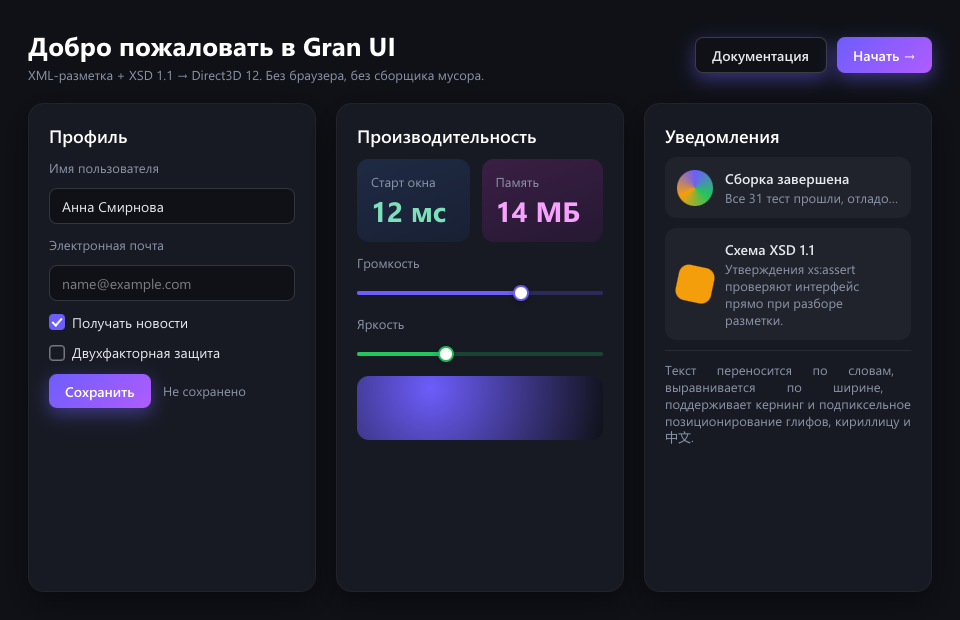
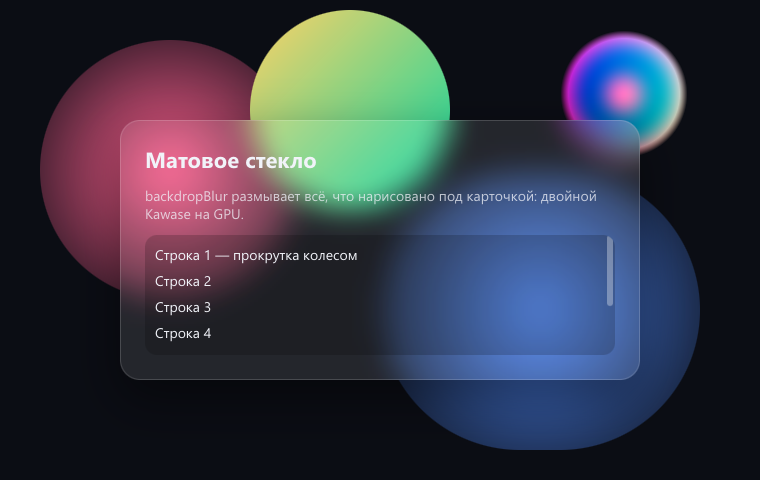

# Грань UI

**Русский** · [English](README.en.md)

**Грань UI** (Gran UI) — движок пользовательского интерфейса на **C++17**: окно описывается XML-разметкой, оформляется
стилями в синтаксисе CSS и рисуется через **Direct3D 12/11 на Windows или Vulkan на Linux**. Цель — картинка уровня
HTML + CSS (градиенты, тени, скругления, матовое стекло, плавные переходы) без браузера, без сборщика мусора
и без сторонних зависимостей: старт за миллисекунды и 0 % процессора в простое. Если веб-страница всё же нужна,
её можно встроить элементом `<WebView>` — браузер системы появляется только внутри него и только когда он виден.

Разметку разбирает и проверяет XML-библиотека [«Берёста»](https://github.com/ErmaleyAlekov/beresta) того же
автора: схема XSD 1.1 встроена в движок, и ошибка в разметке видна со строкой, столбцом и путём ещё до создания окна.

Название — от грани: интерфейс собирается из чётких граней-блоков, как кристалл.



```xml
<Window title="Привет" width="420" height="200" background="#0f1117" color="#e6e8ee">
  <Stack padding="24" spacing="12">
    <Text fontSize="20" fontWeight="600">Привет, Грань UI</Text>
    <Input id="name" placeholder="Как вас зовут?"/>
    <Button text="Поздороваться" onClick="greet" background="linear-gradient(135deg, #6d5dfc, #b05cff)"/>
  </Stack>
</Window>
```

```cpp
gran::Application app;
app.loadFile("hello.xml");
app.onAction("greet", GreetAction{&app});   // onClick="greet" → функция C++
return app.run();
```

> **Состояние:** движок в разработке. Windows 10/11 — Direct3D 12/11 и Win32; Linux — Vulkan 1.0 и X11
> (в Wayland-сеансе нужен XWayland). Программный рендеринг: WARP на Windows, Mesa lavapipe на Linux.
> macOS пока не поддерживается. Программный интерфейс может меняться.

## Linux, включая российские дистрибутивы

Движок использует «Берёсту», C++17 и системный графический стек: Vulkan loader, драйвер Vulkan и X11.
SDL, GLFW, Qt, GTK, FreeType и Fontconfig не нужны. При отсутствии подходящего GPU выбирается CPU-устройство
Mesa lavapipe; `--software` принудительно включает CPU. На целевой машине **Vulkan SDK не нужен**:
SDK содержит заголовки и инструменты для сборки, а Mesa предоставляет драйвер для запуска. Если нет ни
loader, ни драйвера Vulkan, их нужно установить средствами ОС — движок не скачивает их автоматически.

Тот же путь сборки предназначен для Astra Linux, Альт и РЕД ОС при наличии C++17, Vulkan 1.0 и X11/XWayland;
конкретную редакцию, архитектуру и сертифицированный набор пакетов необходимо проверять в её окружении.
Шейдеры SPIR-V встроены, компилятор шейдеров при обычной сборке не требуется.

```bash
cmake -S . -B build -DGRAN_BERESTA_DIR=../beresta
cmake --build build -j
ctest --test-dir build --output-on-failure
./build/bin/gran_gallery samples/showcase.xml --vulkan
./build/bin/gran_snapshot samples/glass.xml glass.png --software
```

Для сборки нужны заголовки Vulkan SDK (или системный пакет заголовков Vulkan) и заголовки системного X11.
Галерея, снимки и C ABI работают на Linux; пример чата пока использует WinSock и собирается только на Windows.
В Linux `<WebView>` остаётся обычным блоком без браузера; провайдер AT-SPI ещё не реализован.
Подробнее — [сборка и проверки Linux](docs/building.md#linux).

---

## Документация

- [Руководство: разметка, стили и программный интерфейс](docs/guide.md)
- [Справочник C++ API и перезагрузка XML](docs/api.md)
- [C ABI и обёртки Python, C#, Java](docs/bindings.md)
- [Проверки отрисовки и эталоны WARP](docs/render_testing.md)
- [Сборка и подключение](docs/building.md)
- [Архитектура движка](docs/architecture.md)
- [Устройство проекта, тесты и правила кода](docs/development.md)
- [Безопасность: что считается уязвимостью и как о ней сообщить](SECURITY.md)

---

## Преимущества

### Лёгкий
- **Ни браузера, ни JavaScript, ни сборщика мусора.** Движок и «Берёста» собираются статически.
  Windows также использует статический runtime C++; Linux — стандартный runtime системы и системные Vulkan/X11.
  Пример-чат для Windows после `strip` весит около **3 МБ**.
- **Браузер — только по требованию.** Встроенная веб-страница (`<WebView>`) — необязательная часть: она включается
  при сборке, браузер системы создаётся при первом показе элемента, а программы без `WebView` его не загружают.
- **Своя память движка с открытым окном — около 5 МБ**; остальное занимает драйвер видеокарты.
- **Быстрый старт:** первый кадр витрины из 47 элементов — за десятки миллисекунд (разбор со схемой 4–8 мс,
  стили и компоновка 5–16 мс, сцена около 9 мс).
- **0 % процессора в простое:** кадр рисуется только когда что-то изменилось или идёт анимация.
- **Ноль сторонних зависимостей:** нечего обновлять, нечему ломаться в чужом пакете.

### Строгий к разметке
- **Каждый файл проверяется схемой XSD 1.1 прямо во время разбора** — до создания окна. HTML молча
  прощает ошибки и рисует «как получится»; Грань UI не загрузит окно с ошибкой.
- **Ловится то, что в вебе всплывает только на экране:** опечатка в имени элемента или атрибута, неверный цвет
  или длина, ссылка на необъявленный стиль, повторный `id`, `minWidth` больше `maxWidth`, номер строки `Grid`
  за пределами дорожек, `Scroll` с двумя детьми, кнопка без текста.
- **Ошибки — все сразу, с местом:**
  `строка 21, столбец 7: /Window/Stack/Grid/Box[2]: атрибут "transformOrigin": значение "center" не соответствует шаблону …`
- **Единые правила:** одинаковые имена атрибутов у всех элементов (camelCase), предсказуемая модель блока без
  схлопывания отступов, `minWidth`/`maxWidth` соблюдаются всегда.

### Безопасный
- **Разметка — только данные.** В ней нет скриптов и выражений: `onClick`, `onChange`, `onSubmit` — лишь имена
  действий, а выполняется только то, что программа сама связала с функциями C++. Неизвестное действие ничего
  не делает.
- **Интерфейс без браузера и сети:** разметка, шрифты и картинки читаются только из локальных файлов.
  Веб-содержимое возможно только внутри явного `<WebView>`: страница работает в отдельном процессе браузера
  системы и общается с программой лишь строками — объекты C++ скрипту страницы недоступны.
- **Защищённый разбор XML:** «Берёста» не загружает внешние DTD и XInclude, ограничивает раскрытие сущностей
  (защита от «миллиарда смехов») и глубину вложенности (не больше 256 уровней).
- **Свои парсеры проверяют каждый байт:** PNG — CRC каждого чанка, пределы размера картинки (16 384 пикселя
  по стороне, 32 Мпикс), inflate с пределом размера результата; TrueType — проверка границ при каждом чтении
  и предел вложенности составных глифов. Испорченный файл даёт ошибку, а не выход за границы памяти.
- **Аккуратная работа с видеокартой:** каждая запись в буфер GPU проверяется против ёмкости, ресурс удаляется
  только когда GPU с ним закончил, отладочный слой D3D12 включён в проверках кадров.

---

## Возможности

### Разметка и стили
- **Элементы:** `Window`, `Stack`, `Grid`, `Canvas`, `Box`, `Scroll`, `Text` с участками `Span`, `Image`, `Button`,
  `Input` (в том числе пароль), `TextArea`, `CheckBox`, `Switch`, `RadioButton`, `Slider`, `ProgressBar`, `ComboBox`, `Tabs`, `Popup`,
  `MenuItem`, `Dialog` и `WebView` (по желанию).
- **Списки из данных:** `items="модель"` + `<ItemTemplate>` с подстановками `{поле}`; данные — в `<Data>`
  или в модели из кода, правка модели меняет только затронутые записи. Фрагменты разметки во время работы
  (`appendMarkup`) проверяются той же схемой.
- **Схема XSD 1.1 проверяет разметку во время разбора:** типы значений (цвета, длины, дорожки Grid),
  утверждения `xs:assert` (`minWidth ≤ maxWidth`, номер строки Grid меньше числа дорожек, у кнопки есть текст),
  уникальные `id` и ссылки только на объявленные стили (`xs:key`/`xs:keyref`).
- **Стили в синтаксисе CSS:** цвета (`#rgb`, `rgba()`, `hsl()`, имена), градиенты `linear`/`radial`/`conic`,
  `boxShadow` (внешние и внутренние), раздельные радиусы углов, `transform`, `opacity`, `backdropBlur`.
- **Каскад:** умолчания ← тема ← именованный `Style` (с наследованием `basedOn`) ← атрибуты ← состояния
  `Hover`, `Pressed`, `Focused`, `Checked`, `Disabled`. Токены темы — `$имя`.
- **Переходы и анимации:** `transition` с кривыми `ease`, `linear`, `cubic-bezier()`, `steps()`; анимации по ключевым
  кадрам `<Keyframes>` + `animation` (повторы, `infinite`, `alternate`, задержка, заполнение), в том числе по состоянию
  (`<Hover animation="…"/>`); таймеры `setTimeout`/`setInterval` в потоке интерфейса.

### Компоновка
- `Stack` — подмножество flexbox: `justify`, `align`, `grow`/`shrink`, `wrap`, `alignSelf`.
- `Grid` — дорожки `48`, `auto`, `1fr`, `minmax(100, 1fr)`, объединение ячеек.
- `Canvas` — абсолютное размещение; `Scroll` — прокрутка с полосами и колесом.
- Предсказуемая модель блока: `margin` без схлопывания, `minWidth`/`maxWidth` соблюдаются всегда.
- Локальная перекомпоновка: пересчитывается только изменившаяся ветвь, неизменившиеся блоки берут размеры из кэша
  или только сдвигаются (правка записи в списке из 10 000 — около 1 мс).
- Виртуальные списки (`virtual="true"`): узлы есть только у видимых записей — 100 000 записей строятся за доли
  миллисекунды.

### Текст
- Собственный разбор шрифтов TrueType и TTC: `cmap`, `glyf`, составные глифы, кернинг `kern` и `GPOS`.
- Растеризация точной площадью покрытия с подпиксельным сдвигом, как в браузерах; атлас глифов на видеокарте.
- Перенос по словам, выравнивание по ширине, многоточие, замена шрифта для CJK.
- Выделение мышью и клавиатурой, буфер обмена, контекстное меню, оформленный текст (жирный, курсив, код, ссылки).

### Отрисовка
- Один шейдер и один вызов отрисовки на кадр: каждый прямоугольник, тень и глиф — экземпляр в общем буфере.
- Скруглённые прямоугольники и отсечения через SDF, аналитическое сглаживание без MSAA.
- Матовое стекло: размытие подложки двойным Kawase.
- Кадров в полёте — два, кольцевой буфер загрузки, отложенное удаление ресурсов; отладочный слой D3D12 и GPU-Based Validation.
- Сохранённый режим: пересчитывается только изменившееся; нет изменений и анимаций — нет кадров.

### Приложение
- Цикл событий, действия из разметки (`onClick`, `onChange`, `onSubmit`) связываются с функциями C++.
- Фокус и Tab, поля ввода, всплывающие меню с подменю, выпадающие списки, модальные диалоги с затемнением
  и подсказки (`tooltip`); меню открываются и с клавиатуры.
- Гибрид с вебом: `<WebView>` показывает страницу браузера системы (Windows — WebView2) внутри окна движка;
  браузер создаётся лениво, страница — в отдельном процессе, мост с программой — строковые сообщения.
- Доступность: провайдер Microsoft UI Automation — экранные дикторы видят кнопки, поля, флажки, ползунки и тексты
  и управляют ими сами (нажать, переключить, выбрать, ввести текст, задать число); имена — `accessibleName` и `labeledBy`.
- Несколько окон (`openWindow`), `onClose` с подтверждением, системные диалоги открытия, сохранения и выбора папки,
  перетаскивание файлов из Проводника на зону `onDrop` с подсветкой.
- Векторные иконки `<Icon>`: путь SVG или файл `.svg`, резкие при любом масштабе, цвет — как у текста.
- PNG и JPEG (в том числе прогрессивный) — свои декодеры и свой inflate. Сообщения об ошибках — на русском и английском.

### Инженерные качества
- **Зависимости:** «Берёста», стандартная библиотека C++17 и системный графический SDK/драйвер.
- **Сборка:** Makefile с автозависимостями и CMake; MinGW-w64, MSVC, GCC и Clang.
- **Проверка без окна:** `gran_snapshot` рисует разметку вне экрана в PNG — кадр можно сравнить с эталоном.
- **Читаемый код:** короткие функции и небольшие файлы, подробные двуязычные комментарии (русский и английский).

---

## Примеры

| Программа | Что показывает |
|---|---|
| `gran_gallery [разметка.xml]` | Живое окно с любой разметкой из `samples/` (по умолчанию — витрина) |
| `gran_snapshot <разметка.xml> <кадр.png> [ширина высота [масштаб]]` | Кадр без окна в PNG |
| `gran_chat [--model имя]` | Чат с локальной моделью через [Ollama](https://ollama.com): потоковый ответ, Markdown, многострочное поле |



---

## Кто что делает

Грань UI создаётся человеком вместе с двумя языковыми моделями. Решения принимает человек, а модели
работают по его заданиям. Каждую правку проверяют модульные тесты, кадры вне экрана и запуск живых окон.

| Участник | Роль |
|---|---|
| **Ермаков Алексей Александрович** — автор и правообладатель | Основная идея и концепция движка, постановка задач и решения. Создание и редактирование правил генерации кода для обеих моделей, в том числе правил работы с видеокартой. Проверка кода в отладчике, поиск ошибок. Проверка внешнего вида и поведения живых окон. Автор XML-библиотеки «Берёста», на которой построен движок. |
| **Claude** (Anthropic), ассистент в Claude Code | Архитектура и проектирование модулей. Реализация большей части кода: загрузка разметки и схема, стили и каскад, компоновка, шрифты и текст, сцена и бэкенд Direct3D 12, шейдеры, ввод, анимации, доступность, примеры. Диагностика ошибок, сборка, документация. Проверка кода локальной модели. |
| **Qwen2.5-Coder 14B** (Alibaba), локальная модель | Простой шаблонный код по готовому заданию: модульные тесты, заголовки с объявлениями, переводы документации на английский. |

Права на программу принадлежат правообладателю (см. [LICENSE](LICENSE)).

---

## Лицензия

Грань UI — **закрытое программное обеспечение**, все права принадлежат Ермакову Алексею Александровичу.
Использование, копирование, изменение и распространение — только по письменному договору с правообладателем;
условия — в файле [LICENSE](LICENSE). «Берёста» — отдельный открытый проект под лицензией MIT.
