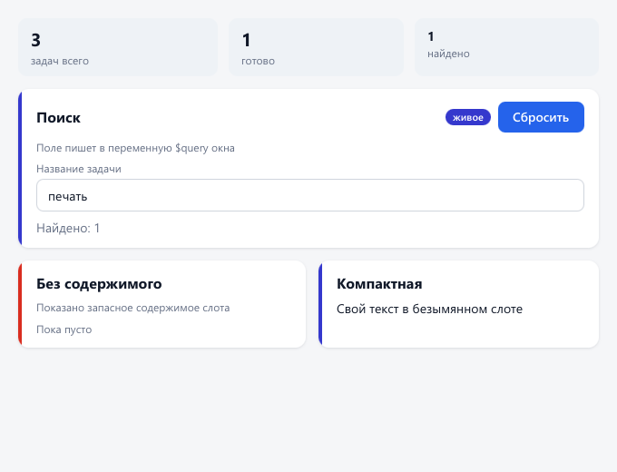

# Грань UI — руководство

**Русский** · [English](guide.en.md)

← [К описанию](../README.md)

## Содержание

1. [Быстрый старт](#быстрый-старт)
2. [Окно и ресурсы](#окно-и-ресурсы)
3. [Элементы](#элементы)
4. [Компоновка](#компоновка)
5. [Значения стилей](#значения-стилей)
6. [Стили, тема и состояния](#стили-тема-и-состояния)
7. [Анимации и таймеры](#анимации-и-таймеры)
8. [Текст и шрифты](#текст-и-шрифты)
9. [Действия и программный интерфейс](#действия-и-программный-интерфейс)
10. [События](#события)
11. [Команды и горячие клавиши](#команды-и-горячие-клавиши)
12. [Отмена и повтор](#отмена-и-повтор)
13. [Списки из данных](#списки-из-данных)
14. [Выражения привязки](#выражения-привязки)
15. [Компоненты](#компоненты)
16. [Вкладки, радиокнопки, переключатели](#вкладки-радиокнопки-переключатели)
17. [Всплывающие слои](#всплывающие-слои)
18. [Встроенный браузер: WebView](#встроенный-браузер-webview)
19. [Доступность](#доступность)
20. [Платформа: окна, файлы, иконки](#платформа-окна-файлы-иконки)
21. [Ошибки и язык сообщений](#ошибки-и-язык-сообщений)
22. [Свой заголовок окна](#свой-заголовок-окна)

## Быстрый старт

`hello.xml`:

```xml
<?xml version="1.0" encoding="UTF-8"?>
<Window title="Привет" width="420" height="220" background="#0f1117" color="#e6e8ee" fontSize="14">
  <Stack padding="24" spacing="12">
    <Text fontSize="20" fontWeight="600">Привет, Грань UI</Text>
    <Input id="name" placeholder="Как вас зовут?"/>
    <Stack orientation="horizontal" spacing="12" align="center">
      <Button text="Поздороваться" onClick="greet"/>
      <Text id="answer" color="#8b93a7"/>
    </Stack>
  </Stack>
</Window>
```

`main.cpp`:

```cpp
#include "gran/app/application.hpp"
#include <iostream>

// Действие кнопки: прочитать поле и показать ответ
struct GreetAction
{
    gran::Application* app;

    void operator()(gran::ui::Node& button) const
    {
        gran::ui::Node* name = app->find("name");
        gran::ui::Node* answer = app->find("answer");
        (void)button;
        if (name == nullptr || answer == nullptr)
            return;
        answer->content.text = "Привет, " + name->content.text + "!";
        gran::ui::markDirty(*answer, gran::ui::DIRTY_LAYOUT | gran::ui::DIRTY_PAINT);
    }
};

int main()
{
    try
    {
        gran::Application app;
        app.loadFile("hello.xml");
        app.onAction("greet", GreetAction{&app});
        return app.run();
    }
    catch (const std::exception& error)
    {
        std::cerr << error.what() << '\n';
        return 1;
    }
}
```

Как собрать — в [docs/building.md](building.md#подключение-к-своей-программе). Готовые разметки для опытов —
в `samples/`, их открывает `bin/gran_gallery <файл.xml>`.

## Свой заголовок окна

Обычное окно ОС остаётся значением по умолчанию: `titleBar="system"`. Для собственного заголовка
задайте `titleBar="custom"` у `<Window>` и нарисуйте заголовок и кнопки обычными элементами:

```xml
<Window title="Пример" titleBar="custom" width="800" height="500" minWidth="400" minHeight="240">
  <Stack>
    <Stack orientation="horizontal" windowRole="drag" height="40" align="center">
      <Text>Моя программа</Text>
      <Box grow="1"/>
      <Button windowRole="minimize" text="−"/>
      <Button windowRole="maximize" text="□"/>
      <Button windowRole="close" text="×"/>
    </Stack>
    <Text>Содержимое окна</Text>
  </Stack>
</Window>
```

`drag` использует системное перемещение, двойной щелчок, Aero Snap и контекстное меню заголовка;
Alt+Space открывает системное меню. Поля ввода, кнопки, WebView и элементы с `onClick` внутри `drag`
остаются интерактивными. Края и углы изменяют размер с учётом DPI, в развёрнутом режиме содержимое
остаётся в рабочей области монитора. `resizable="false"` выключает изменение размера и разворачивание.
На Windows 11 наведение на `windowRole="maximize"` показывает Snap Layouts, если это включено в ОС.
Тень и скругление предоставляет DWM; Windows 10 может оставить прямые углы.

Команды ролей работают без `onClick` и доступны с клавиатуры и дикторам; явное `accessibleName`
переопределяет локализованное имя команды. При разворачивании `maximize` меняется на восстановление.
Для смены значка задайте дочерним элементам `<Maximized opacity="…"/>` после остальных состояний.
Пример с двумя значками и полем ввода: `bin/gran_gallery samples/custom_window.xml --d3d11 --debug`.

## Окно и ресурсы

Корень документа — `<Window>`: `title`, `width`, `height` (по умолчанию 800 × 600), `minWidth`, `minHeight`, `onClose`,
а также любые атрибуты оформления, которые наследуют дети (`background`, `color`, `fontSize`, `fontFamily`).
Внутри — необязательный `<Resources>` и ровно один корневой элемент интерфейса.

```xml
<Window title="Окно" width="960" height="620">
  <Resources>
    <Theme>
      <Token name="accent" value="#6d5dfc"/>
      <Token name="radius" value="16"/>
    </Theme>
    <Font family="Inter" source="fonts/Inter-Regular.ttf" weight="400"/>
    <Style name="card" background="#171a23" borderRadius="$radius" padding="20"/>
  </Resources>
  <Stack style="card">…</Stack>
</Window>
```

Разметка проверяется встроенной схемой XSD 1.1 (`schemas/gran-ui.xsd`) прямо во время разбора. Неизвестный
атрибут, неверный цвет, ссылка на необъявленный стиль, повторный `id`, `minWidth` больше `maxWidth` или номер
строки `Grid` за пределами дорожек — ошибка с номером строки и путём ещё до создания окна.

## Элементы

| Элемент | Назначение | Свои атрибуты |
|---|---|---|
| `Stack` | Ряд или столбец детей (подмножество flexbox) | `orientation`, `spacing`, `justify`, `align`, `wrap` |
| `Grid` | Сетка строк и столбцов | `rows`, `columns`, `rowSpacing`, `columnSpacing` |
| `Canvas` | Абсолютное размещение детей | у детей `left`, `top`, `right`, `bottom` |
| `Box` | Пустой прямоугольник (фон, рамка, тень) | — |
| `Scroll` | Прокрутка ровно одного ребёнка | `direction="vertical\|horizontal\|both"` |
| `Text` | Текст, может содержать участки `Span` | `textWrap`, `textOverflow`, `maxLines`, `textAlign` |
| `Span` | Участок оформленного текста внутри `Text` | шрифт, `color`, `background`, `textDecoration`, `onClick` (ссылка) |
| `Icon` | Векторная иконка: путь SVG или файл `.svg`, цвет — `color` | `data`, `viewBox`, `fillRule`, `source` |
| `Image` | Картинка PNG или JPEG | `source`, `fit="fill\|contain\|cover\|none"` |
| `Button` | Кнопка с текстом или содержимым | `text`, `onClick`, `popup` (id своего меню или диалога) |
| `Input` | Однострочное поле | `value`, `placeholder`, `maxLength`, `password`, `readOnly`, `onChange`, `onSubmit` |
| `TextArea` | Многострочное поле с переносом и прокруткой | `rows`, `submitKey="ctrlEnter\|enter"`, `maxHeight`, `onSubmit` |
| `CheckBox` | Флажок | `text`, `checked`, `onChange` |
| `Slider` | Ползунок | `min`, `max`, `value`, `step`, `onChange` |
| `RadioButton` | Радиокнопка: из группы отмечена одна | `text`, `value`, `checked`, `group`, `onChange` |
| `Switch` | Переключатель (флажок другого вида) | `text`, `checked`, `onChange` |
| `ProgressBar` | Полоса прогресса | `min`, `max`, `value` |
| `Tabs` | Вкладки: полоса заголовков и выбранная страница | `value`, `onChange`, страницы `Tab` (`text`, `value`) |
| `Popup` | Всплывающий слой (скрыт, пока его не покажут) | — |
| `MenuItem` | Пункт меню в `Popup`; вложенный `Popup` — подменю | `text`, `onClick`, `value` (для `ComboBox`) |
| `Dialog` | Модальный диалог по центру окна | `closable` |
| `ComboBox` | Выпадающий список с выбранным значением | `value`, `placeholder`, `onChange`, пункты `MenuItem` или `items` |
| `WebView` | Страница системного браузера (по желанию, см. [ниже](#встроенный-браузер-webview)) | `source` или HTML в теге, `onMessage` |
| `ItemTemplate` | Вид одной записи списка внутри контейнера с `items` | ровно один элемент |

Контейнеры (`Stack`, `Box`, `Grid`, `Canvas`, `Button`, `Popup`, `Dialog`) и `ComboBox` принимают `items="модель"`
вместе с `<ItemTemplate>` — см. [Списки из данных](#списки-из-данных).

Общие атрибуты всех элементов: `id`, `style`, `visible`, `enabled`, `tooltip`, `accessibleName`, `labeledBy`
(см. [Доступность](#доступность)), атрибуты размеров, отступов и оформления. Имена атрибутов — camelCase и одинаковые у всех элементов.

## Компоновка

Модель блока: `margin` (без схлопывания) → `borderWidth` → `padding` → содержимое. `width` и `height` — `auto`,
пиксели или проценты; `minWidth`, `maxWidth`, `minHeight`, `maxHeight` соблюдаются всегда. Отступы пишутся как в
CSS: `padding="8"`, `"8 16"`, `"4 8 12 16"`.

**Stack.** `orientation="vertical|horizontal"`, `spacing` — зазор между детьми. `justify` распределяет детей
по главной оси (`start`, `center`, `end`, `space-between`, `space-around`, `space-evenly`), `align` — по
поперечной (`start`, `center`, `end`, `stretch`). У детей: `grow`, `shrink`, `alignSelf`. `wrap="true"` переносит
детей на новую строку.

**Grid.** Дорожки перечисляются через запятую: число (пиксели), `auto`, `1fr`, `minmax(100, 1fr)`.

```xml
<Grid rows="auto, 1fr" columns="1fr, 1fr, 1fr" rowSpacing="20" columnSpacing="20">
  <Text gridColumnSpan="3">Заголовок во всю ширину</Text>
  <Box gridRow="1" gridColumn="0"/>
  <Box gridRow="1" gridColumn="1" gridColumnSpan="2"/>
</Grid>
```

Номера строк и столбцов — с нуля.

**Canvas.** Дети ставятся по `left`/`top`/`right`/`bottom`; `zIndex` меняет порядок наложения.

**Scroll.** Ребёнок больше `Scroll` — появляется полоса прокрутки, работают колесо и перетаскивание ползунка.

## Значения стилей

| Что | Примеры |
|---|---|
| Цвет | `#rgb`, `#rrggbb`, `#rrggbbaa`, `rgb(…)`, `rgba(…)`, `hsl(…)`, `transparent`, имена CSS, `$токен` |
| Заливка (`background`) | цвет; `linear-gradient(135deg, #6d5dfc, #b05cff)`; `radial-gradient(…)`; `conic-gradient(…)` |
| Скругление | `borderRadius="12"` или по углам `"12 12 0 0"` |
| Тень | `boxShadow="0 10 30 rgba(0, 0, 0, 0.45)"`, несколько через запятую, `inset` — внутренняя |
| Преобразование | `transform="rotate(12deg) scale(1.05) translate(4, 0)"`, `transformOrigin` |
| Прозрачность и стекло | `opacity="0.8"`, `backdropBlur="24"` — размытие того, что под элементом |
| Переход | `transition="background 0.15s ease, transform 0.1s cubic-bezier(0.2, 0, 0, 1)"` |
| Анимация | `animation="pulse 0.8s ease-in-out infinite alternate"` — по ключевым кадрам `<Keyframes>` |
| Курсор | `cursor="pointer\|text\|default"` |

Длины — в логических пикселях: на экране с масштабом 150 % движок сам умножает их на 1,5.
Цвета и смешивание — в sRGB с предумноженной альфой, как в браузерах.

## Стили, тема и состояния

Каскад, от слабого к сильному: умолчания движка ← встроенная тема (`schemas/default_theme.xml`) ← стиль
`style="имя"` ← атрибуты элемента ← активные состояния.

```xml
<Style name="primary" background="linear-gradient(135deg, #6d5dfc, #b05cff)" color="#ffffff">
  <Hover boxShadow="0 6 18 rgba(109, 93, 252, 0.45)"/>
  <Pressed transform="scale(0.98)"/>
  <Disabled opacity="0.5"/>
</Style>
<Style name="ghost" basedOn="primary" background="transparent" borderWidth="1"/>
```

- Состояния: `Hover`, `Pressed`, `Focused`, `Checked`, `Disabled`, `DropTarget` (над зоной `onDrop` несут файлы). Смена состояния плавная, если у свойства
  есть `transition`; состояние может и запустить анимацию: `<Hover animation="wiggle 0.4s"/>`.
- `basedOn` наследует другой стиль. Тема по умолчанию задаёт стили с именами элементов (`Button`, `Input`,
  `TextArea`, `CheckBox`, `Slider`, `RadioButton`, `Switch`, `ProgressBar`, `Tabs`, `TabBar`, `TabHeader`, `Tab`,
  `Scroll`, `Popup`, `MenuItem`, `Dialog`, `ComboBox`, `Tooltip`) — свой `Style`
  с таким именем их заменяет.
- Токены темы (`<Token name="accent" value="#6d5dfc"/>`) подставляются в любое значение как `$accent`.
- `color`, `accentColor`, шрифт и кегль наследуются детьми, как в CSS.

## Анимации и таймеры

**Переходы** (`transition`) плавно ведут свойство от старого значения к новому, когда меняется состояние
или стиль. **Анимации по ключевым кадрам** играют сами — при загрузке, при появлении состояния, бесконечно, —
как `@keyframes` в CSS.

```xml
<Resources>
  <Keyframes name="pulse">
    <Frame at="0%" opacity="1" transform="scale(1)"/>
    <Frame at="100%" opacity="0.35" transform="scale(0.8)"/>
  </Keyframes>
  <Keyframes name="appear">
    <Frame at="0%" opacity="0" transform="translate(0, 16)"/>
  </Keyframes>
  <Style name="card" background="#ffffff" padding="16" animation="appear 0.6s ease-out"/>
</Resources>
…
<Box width="28" height="28" borderRadius="14" background="#e11d48"
     animation="pulse 0.8s ease-in-out infinite alternate"/>
```

- `<Keyframes name>` объявляются в `<Resources>` до стилей. В кадре `<Frame at="0%…100%">` — только анимируемые
  свойства: `background` (цвет), `borderColor`, `color`, `accentColor`, `opacity`, `transform`, `boxShadow`,
  `borderRadius`. Свойство, которого нет в кадре 0 % или 100 %, берёт там своё обычное значение (так `appear`
  выше задаёт только начало). `easing` у кадра — кривая участка до следующего кадра.
- `animation="имя длительность [кривая] [задержка] [повторы|infinite] [направление] [заполнение]"`, несколько —
  через запятую, `none` — без анимации. Направление: `normal`, `reverse`, `alternate`, `alternate-reverse`;
  заполнение: `none`, `forwards` (держать последний кадр), `backwards` (первый кадр во время задержки), `both`.
  В отличие от CSS имя всегда стоит первым.
- Анимация запускается, когда имя появляется в стиле узла (загрузка, `setStyle`, состояние вроде `Hover`),
  и снимается, когда исчезает. Закончившаяся не повторяется, пока имя остаётся в стиле; чтобы проиграть её
  снова, смените стиль узла на стиль без неё, а в следующем кадре — обратно.
- Свойства, которые ведёт анимация, переходами не анимируются. Анимации скрытых узлов (`visible="false"` у узла
  или предка: закрытый слой, другая вкладка) не будят перерисовку и при показе сразу оказываются на своём месте.
- Необъявленное имя в `animation` — ошибка загрузки с номером строки. Градиенты и преобразования разной формы
  (`rotate` → `scale`) не смешиваются: значение меняется скачком.

**Таймеры** — функции, которые цикл событий вызывает в потоке интерфейса:

```cpp
gran::TimerId tick = app.setInterval(0.05, ProgressTick{&app});   // каждые 50 мс
app.setTimeout(2.0, ShowHint{&app});                              // один раз через 2 секунды
app.clearTimer(tick);
```

- После срабатывания кадр перерисовывается; в простое поток спит до срока ближайшего таймера. Точность — кадр
  (около 16 мс при vsync) или пробуждение цикла; период не меньше 1 мс.
- Периодический таймер вызывает один и тот же объект-функцию: его поля (например, счётчик) сохраняются между
  срабатываниями. Пропущенные срабатывания (поток был занят) не догоняются пачкой.
- Таймер можно снять из его же обработчика; таймер, поставленный обработчиком, сработает не раньше следующего
  прохода цикла. Ставить и снимать таймеры можно только в потоке интерфейса — фоновый поток делает это через `post`.

Образец — `samples/animations.xml` (`gran_gallery samples/animations.xml`): вращение, пульс, смена цвета,
неопределённый прогресс, появление карточек, анимация при наведении; полоса и счётчик секунд — таймерами галереи.

## Текст и шрифты

- Шрифт: `fontFamily`, `fontSize`, `fontWeight` (100–900), `fontStyle="italic"`, `letterSpacing`, `lineHeight`.
  Системные шрифты Windows находятся по имени семейства; свой файл подключается в ресурсах
  `<Font family="…" source="путь.ttf" weight="…" italic="…"/>`. Глифов нет в шрифте (китайский, японский) —
  движок сам берёт запасной системный шрифт.
- `textWrap="wrap|nowrap"`, `textAlign="start|center|end|justify"`, `textOverflow="ellipsis"`, `maxLines`.
- Оформленный текст — участки `Span` внутри `Text`; пробелы схлопываются через границы участков, перенос идёт
  сквозь них:

```xml
<Text lineHeight="1.6">Обычный, <Span fontWeight="700">жирный</Span>,
  <Span fontStyle="italic">курсив</Span> и <Span style="link" onClick="open">ссылка</Span>.</Text>
```

- Текст `Text` и полей выделяется мышью (двойной щелчок — слово) и клавиатурой (Shift+стрелки, Ctrl+A),
  копируется Ctrl+C и через контекстное меню по правому щелчку. Поле `password="true"` показывает точки и не даёт
  копировать.

## Действия и программный интерфейс

Атрибуты `onClick`, `onChange`, `onSubmit` содержат имя действия. Приложение связывает имя с функцией:

```cpp
app.onAction("save", SaveAction{&app});   // функция получает узел, вызвавший действие
```

`onClick` — щелчок или Enter/Пробел на кнопке, пункте меню, ссылке. `onChange` — изменение поля, флажка,
переключателя, ползунка, выбор радиокнопки (действие у отмеченной) или вкладки (действие у `Tabs`). `onSubmit` — Enter в `Input`, клавиша `submitKey` в `TextArea`.

Класс `gran::Application` (`gran/app/application.hpp`):

| Метод | Что делает |
|---|---|
| `Application(AppOptions)` | `debugLayer` — отладочный слой D3D12, `vsync`, `exitAfter` — выход через N секунд |
| `loadFile(путь)` / `loadString(разметка)` | Загрузить и проверить разметку, построить окно |
| `onAction(имя, функция)` | Связать имя действия из разметки с функцией C++ |
| `onEvent(имя, функция)` | Обработчик событий разметки (`onPointerDown="имя"`…), функция получает узел и `UiEvent` |
| `addEventListener(узел, вид, функция, захват)` / `removeEventListener` | Слушатель события у узла из кода |
| `dispatchEvent(узел, вид, строка)` | Своё событие: захват → цель → всплытие; `false` — отменено |
| `capturePointer(узел)` / `releasePointer(узел)` | Захват указателя до отпускания кнопки |
| `find(id)` | Найти узел по `id` (или `nullptr`) |
| `setStyle(узел, имя)` | Сменить именованный стиль узла |
| `append(родитель, узел)` / `remove(узел)` | Вставить узел (например, копию шаблона `ui::cloneTree`) / удалить |
| `appendMarkup(родитель, "<Stack>…</Stack>")` | Вставить фрагмент разметки (та же схема, стили и тема документа) |
| `markupAttribute(узел, имя)` / `setMarkupAttribute(узел, имя, значение)` / `removeMarkupAttribute` | Атрибут узла в живой разметке: прочитать / записать с проверкой схемой и перестройкой узла / удалить |
| `saveMarkup()` / `saveMarkupFile(путь)` | Живая разметка окна как XML (с правками, вставками и удалениями) |
| `model(имя)` / `itemOf(узел)` | Модель списка `items="имя"` / запись, к которой относится узел |
| `onWebMessage`, `postWebMessage`, `navigate`, `loadHtml` | Встроенный браузер `<WebView>` |
| `focus(узел)` | Передать фокус клавиатуры |
| `showPopup(слой, якорь)` / `showPopupAt(слой, точка)` / `hidePopup(слой)` | Всплывающие слои |
| `showDialog(диалог)` / `hideDialog(диалог)` | Модальный диалог |
| `selectOption(список, значение)` | Выбрать пункт `ComboBox` из кода (без `onChange`) |
| `selectTab(вкладки, значение)` | Выбрать страницу `Tabs` из кода (без `onChange`) |
| `setValue(узел, число)` / `setChecked(узел, да/нет)` | Число `ProgressBar`/`Slider`, отметка `CheckBox`/`Switch`/`RadioButton` (без `onChange`) |
| `post(задача)` | Выполнить функцию в потоке интерфейса (безопасно из любого потока) |
| `setTimeout(секунды, функция)` / `setInterval(секунды, функция)` / `clearTimer(номер)` | Таймеры в потоке интерфейса |
| `openWindow(путь)` / `openWindowString(разметка)` / `closeWindow(узел)` | Ещё одно окно / закрыть окно узла |
| `openFileDialog(параметры, несколько)` / `saveFileDialog` / `folderDialog` | Системные диалоги файлов |
| `onFileDrop(имя, функция)` | Файлы, брошенные на элемент с `onDrop="имя"` (узлы — событие `drop`, раздел «События») |
| `run()` | Цикл событий до закрытия главного окна; возвращает код выхода |

Узел `gran::ui::Node` (`gran/ui/node.hpp`) хранит вид элемента, `id`, содержимое `content` (`text`, `value`,
`checked`, `placeholder`…) и вычисленный стиль. После изменения содержимого из кода узел помечается
`ui::markDirty(узел, ui::DIRTY_LAYOUT | ui::DIRTY_PAINT)`: движок перекомпонует и перерисует только нужное.

**Шаблоны.** Повторяющийся блок одинакового вида лучше описать списком из данных (раздел ниже).
Если блок собирается сложнее (как ответ с Markdown в `examples/chat/`), его можно вставить фрагментом
разметки `appendMarkup` или скопировать скрытый образец `ui::cloneTree` и вставить `append`.

**Фоновые потоки.** Обращаться к узлам можно только из потока интерфейса. Поток сети или вычислений передаёт
результат через `app.post(задача)` — задача выполнится в цикле событий, а окно проснётся само.

## События

Кроме действий (`onClick`, `onChange`) у любого элемента есть события — как в DOM браузера. Обработчик
получает узел и событие `ui::UiEvent` (`gran/ui/ui_event.hpp`) и может остановить его или отменить действие
движка по умолчанию.

```xml
<Stack id="board" onKeyDownCapture="hotKeys">
  <Box id="pad" onPointerDown="padDown" onPointerMove="padMove" onWheel="padWheel" onContextMenu="padMenu"/>
</Stack>
```

```cpp
app.onEvent("padMove", [](gran::ui::Node& pad, gran::UiEvent& event) {
    // event.local — точка в системе pad (с его transform), event.position — точка окна
});
app.onEvent("padMenu", [&](gran::ui::Node&, gran::UiEvent& event) {
    event.preventDefault();                                   // без встроенного меню «Копировать / Вставить»
    app.showPopupAt(*app.find("myMenu"), event.position);
});
```

**Маршрут.** Событие идёт от корня к цели (фаза захвата, атрибуты с суффиксом `Capture`), затем у самой цели
и обратно к корню (всплытие). `event.stopPropagation()` останавливает путь (обработчики текущего узла
довызываются), `stopImmediatePropagation()` — сразу. `event.target` — узел, которому событие адресовано,
`event.current` — узел, чей обработчик вызван, `event.phase` — фаза. Путь собирается до доставки; если
обработчик удалил узлы (`remove`, правка модели списка), доставка и действие по умолчанию прекращаются.

| Событие | Атрибут | Цель | Отмена (`preventDefault`) |
|---|---|---|---|
| `keyDown` / `keyUp` | `onKeyDown` / `onKeyUp` | узел в фокусе, без него — верхний слой или корень | `keyDown`: Tab, правка поля, Enter/пробел, стрелки и **символы** этой клавиши |
| `pointerDown` / `pointerUp` | `onPointerDown` / `onPointerUp` | узел под мышью или захвативший указатель | нажатие: фокус, выделение, ползунок, контекстное меню; отпускание: щелчок `onClick` и `doubleClick` |
| `pointerMove` | `onPointerMove` | то же | выделение мышью, ползунок, подменю |
| `pointerEnter` / `pointerLeave` | `onPointerEnter` / `onPointerLeave` | каждый узел, вошедший в цепочку под мышью или вышедший из неё | — (не всплывают) |
| `doubleClick` | `onDoubleClick` | узел под мышью (после второго отпускания) | — |
| `wheel` | `onWheel` | узел под мышью | прокрутка |
| `focus` / `blur` | `onFocus` / `onBlur` | получивший / потерявший фокус | — (не всплывают; `related` — второй узел) |
| `contextMenu` | `onContextMenu` | правый щелчок, клавиша меню, Shift+F10 | встроенное меню текста и полей |
| свои | `on="имя:действие …"` | `Application::dispatchEvent` | по договорённости приложения |

Неотменяемые события (`pointerEnter/Leave`, `focus/blur`, `dragEnter/Leave`, `dragEnd`) `preventDefault`
игнорируют. Уведомления `focus`, `blur`, `pointerEnter`, `pointerLeave` приходят после встроенной обработки
события окна (порядок как в браузере: `pointerDown`, `blur`, `focus`, `pointerUp`, `onClick`). Клавиши —
`event.key` (`platform::Key`: буквы A–Z по физической клавише, цифры, F1–F12, стрелки…), имя —
`platform::keyName(key)` («A», «Enter», «ArrowLeft», «F5»), модификаторы — `event.modifiers`.

**Обработчики.** Имя из атрибута ищется сначала среди `onEvent`, затем среди `onAction` (функция получает
только узел) и встроенных команд: `onDoubleClick="gran:maximize"`, `onPointerDown="gran:capturePointer"`
работают без кода. Из кода — слушатели узла:

```cpp
gran::ListenerId id = app.addEventListener(*app.find("list"), "keyDown", handler, /*capture*/ true);
app.removeEventListener(*app.find("list"), id);   // слушатель уходит и вместе с узлом
```

**Свои события.** `app.dispatchEvent(узел, "itemChosen", "строка")` проходит тот же маршрут; разметка ловит
его атрибутом `on="itemChosen:pickItem"`. Результат — `false`, если обработчик вызвал `preventDefault`.
Так элемент сообщает «наверх», не зная, кто его слушает (пример: кнопка «Сбросить доску» в `samples/events.xml`).

**Захват указателя.** `app.capturePointer(узел)` (или `gran:capturePointer` в разметке) направляет события мыши
узлу, где бы ни была мышь, до отпускания кнопки или `releasePointer(узел)` — так пишутся свои ползунки,
ручки изменения размера, рисование.

### Перетаскивание узлов

```xml
<Stack items="todo" acceptDrop="task" onDrop="moveTask">
  <ItemTemplate>
    <Box style="card" draggable="true" dragFormat="task" dragData="{title}" onDoubleClick="flipTask">…</Box>
  </ItemTemplate>
</Stack>
```

Узел с `draggable="true"` начинает перетаскивание, когда мышь с нажатой кнопкой уходит дальше 4 пикселей.
Данные — формат `dragFormat` (по умолчанию `node`) и строка `dragData` (по умолчанию `id`, в шаблонах —
подстановки `{поле}`); `event.drag` в `dragStart` их можно сменить, `preventDefault` — отменить перетаскивание.
Зона — ближайший к мыши узел с `acceptDrop`, в списке которого есть формат (`*` — любой); поддерево
источника зоной не бывает. Зона получает `dragEnter`, `dragOver` (отмена — «сюда нельзя»), `dragLeave`
и `drop` (`event.related` — перетаскиваемый узел), источник — `dragStart` и `dragEnd` (`event.dropped`).
Пока идёт перетаскивание, источник в состоянии `<Dragging>`, согласная зона — в `<DropTarget>`, курсор
«переместить» или «нельзя»; Esc и потеря фокуса окном отменяют его. `onDrop` у той же зоны принимает и файлы
из Проводника (`onFileDrop`). Типичный обработчик `drop` переносит запись модели списка:

```cpp
app.onEvent("moveTask", [&](gran::ui::Node& column, gran::UiEvent& event) {
    gran::ItemRef item = app.itemOf(*event.related);
    gran::data::Record record = item.model->at(item.index);
    item.model->remove(item.index);                    // узел карточки удаляется привязкой
    app.model(column.content.items).append(record);
});
```

Пример целиком — `gran_gallery samples/events.xml` (обработчики — `examples/gallery/gallery_board.cpp`).

## Команды и горячие клавиши

Команда `<Command>` (как `QAction` в Qt) — одно действие для кнопки, пункта меню и сочетания клавиш.
Элементы ссылаются на неё атрибутом `command`; выключенная команда выключает их все и перестаёт срабатывать
с клавиатуры.

```xml
<Resources>
  <Command id="saveDoc" text="Сохранить" key="Mod+S" action="save"/>
  <Command id="refresh" text="Обновить" key="F5 Mod+R"/>
  <Command id="deleteNote" text="Удалить" key="Del" scope="focus" within="notes" action="deleteNote"/>
  <Command id="quit" text="Выход" key="Mod+Q" action="gran:close"/>
</Resources>
…
<Button command="saveDoc"/>                          <!-- подпись «Сохранить» — из команды -->
<Popup id="fileMenu">
  <MenuItem command="saveDoc"/>                      <!-- справа подпись «Ctrl+S» -->
  <MenuItem command="quit"/>
</Popup>
```

| Атрибут | Значение |
|---|---|
| `id` | имя команды (уникально вместе с `id` элементов окна) |
| `action` | действие (`onAction`, `gran:…`); без него — действие с именем `id` |
| `text` | подпись кнопок и пунктов меню, у которых нет своей |
| `key` | сочетания через пробел: модификаторы `Mod` (= Ctrl), `Ctrl`, `Shift`, `Alt` через `+` и клавиша — `S`, `F5`, `Enter`, `Del`, `Esc`, `Left`, `PgUp`, `Insert`… (регистр не важен) |
| `scope` | `window` (по умолчанию) — в своём окне; `focus` — пока фокус внутри элемента `within`; `global` — во всех окнах программы |
| `enabled` | `false` — команда и её элементы выключены |

**Кто получает клавишу.** Сначала `keyDown` идёт обработчикам (отменённый `preventDefault` до команд не
доходит), затем ищется команда: области `focus`, чей `within` содержит фокус (самый глубокий — первым), затем
`window` и `global` своего окна, затем `global` других окон. Команды не перехватывают то, что элемент в
фокусе делает сам: в поле ввода — набор и правку (всё без Ctrl и Alt, кроме F1–F12; Ctrl+A/C/X/V/Z/Y,
Ctrl+стрелки, Home/End, Backspace/Delete; Ctrl+Alt — это AltGr), у кнопок, флажков и ползунков — стрелки,
пробел и Enter, у выделенного текста — Ctrl+A/C; Tab всегда переводит фокус. При открытом меню или списке
команды не срабатывают, при модальном диалоге — только команды `focus` внутри него. Сочетания действуют
в пределах программы, не во всей системе. Сработавшая команда поглощает клавишу (её символы в поле не попадают).

**Выполнение.** Действие получает узел: для кнопки и пункта меню — их самих, для сочетания — узел в фокусе
(без фокуса — корень окна). Подпись команды получают только элементы без своего `text` и без детей
(кнопка-иконка остаётся без подписи); подпись первого сочетания видна справа в пункте меню и доступна
дикторам (свойство UIA AcceleratorKey). Атрибуты `command` и `enabled` у одного элемента схема запрещает:
включённость задаёт команда.

```cpp
app.onAction("save", [&](gran::ui::Node& from) { /* … */ });
app.setCommandEnabled("saveDoc", false);   // кнопка, пункт меню и Ctrl+S выключены
app.commandEnabled("saveDoc");             // false
app.runCommand("refresh");                 // выполнить из кода; false — нет такой или выключена
```

`setCommandEnabled` действует на все окна, переживает перезагрузку разметки и окна, открытые позже (можно
вызвать и до `loadFile`). В разметке те же операции — `gran:runCommand:id`, `gran:enableCommand:id`,
`gran:disableCommand:id`. Кнопка другого окна может ссылаться на команду `scope="global"` главного окна.
Пример целиком — `gran_gallery samples/commands.xml` (действия — `examples/gallery/gallery_commands.cpp`).

## Отмена и повтор

**В полях.** У каждого `Input` и `TextArea` своя история правок: Ctrl+Z — отменить, Ctrl+Y и Ctrl+Shift+Z —
повторить; те же пункты «Отменить» и «Повторить» есть в контекстном меню поля (выключены, когда шагов нет).
Набор подряд — один шаг (как в браузере и Qt), так же подряд идущие Backspace и подряд идущие Delete. Новый шаг
начинается после перемещения каретки (мышь, стрелки, Home/End, Ctrl+A), паузы в наборе дольше секунды, вставки,
вырезания, удаления выделения и новой строки. Отмена возвращает текст и выделение, какими они были до правки,
и вызывает `onChange`, как обычная правка. История поля — 100 шагов; текст, заданный из кода (`gran_app_apply`,
запись списка, перезагрузка, присваивание `content.text`), её сбрасывает. `undo="false"` у поля — правки
не записываются вовсе (поле, текст которого ведёт код).

**В программе.** Для своих действий (удалить заметку, переместить фигуру) — стеки отмены приложения
(как `QUndoStack`): шаг кладётся уже выполненным, отмена и повтор вызывают его обработчики.

```cpp
std::string removed = notes.take(index);              // действие выполнено
app.pushUndo([&, index, removed] { notes.insert(index, removed); },   // отменить
             [&, index] { notes.take(index); });                     // повторить
app.undo();                     // или <Command action="gran:undo"/>; false — нечего отменять
app.undoStack().setClean();     // документ сохранён
app.onUndoChanged([&](const std::string& stack, const gran::UndoStack& state) {
    showTitle(state.isClean() ? name : "* " + name);  // своя функция: «*» — есть несохранённое
});
```

```xml
<Command id="undo" text="Отменить" key="Mod+Z" action="gran:undo"/>
<Command id="redo" text="Повторить" key="Mod+Y Mod+Shift+Z" action="gran:redo"/>
<Command id="undoLayer" key="Mod+Alt+Z" action="gran:undo:layers"/>   <!-- свой стек "layers" -->
```

Команды с действием `gran:undo`, `gran:redo` (`:имя` — свой стек) включаются и выключаются сами по стеку —
`setCommandEnabled` для них не нужен. Стеки создаются при первом обращении, `""` — основной.

**Поле и программа вместе.** `gran:undo` и `gran:redo` без имени стека сначала работают с редактируемым полем
окна — как Ctrl+Z в нём: «Правка → Отменить» при фокусе в поле отменяет набор, а когда в поле отменять нечего — шаг
программы. Редактируемое поле — поле в фокусе или поле, откуда открыли меню. Кнопки с `command` или `popup`
(панель инструментов, кнопка меню) при щелчке фокус у поля не забирают, как в настольных программах; Tab переводит
на них фокус как обычно. Включённость этих команд учитывает и поле. Именованные стеки (`gran:undo:имя`), а также
`app.undo()` и `gran_app_command("undo")` из кода работают только со стеком программы.

| Операция | Смысл |
|---|---|
| `undoStack(имя)` | Стек (`gran::UndoStack`): `push`, `undo`, `redo`, `canUndo`, `canRedo`, `isClean`, `setClean`, `clear`, `count`, `index`, `setLimit` (0 — без предела) |
| `pushUndo(отменить, повторить, имя)` | Записать выполненное действие парой обработчиков |
| `undo(имя)`, `redo(имя)` | То же, что `gran:undo[:имя]`, `gran:redo[:имя]` |
| `onUndoChanged(обработчик)` | Вызывается после каждой смены любого стека (шаг, отмена, повтор, `setClean`, `clear`) |
| `gran:clearUndo[:имя]`, `gran:setUndoClean[:имя]`, `gran:setUndoLimit:имя:N` | Те же операции из разметки и C ABI |

Свой шаг с объединением — наследник `gran::UndoStep` (`gran/undo/undo_stack.hpp`): `mergeId()` ≥ 0 и
`mergeWith(next)` вбирает следующий шаг того же вида, пока объединение не прервали (`breakMerge`, отмена, повтор,
`setClean`; на «чистой» позиции шаги не сливаются). Предел отбрасывает самые старые шаги; если с ними ушла
«чистая» позиция, `isClean()` к ней уже не вернётся. Обработчик шага не вызывает `undo`/`redo` своего стека,
а шаги, записанные во время отмены, игнорируются (изменение — следствие отмены, а не новая правка).
Стеки переживают перезагрузку разметки — шаги находят узлы по id (`app.find`), а не хранят указатели.
Пример — `gran_gallery samples/commands.xml` (заметки: удаление и добавление отменяются, «*» в заголовке).

## Списки из данных

Разметка описывает вид одной записи, данные живут в модели внутри движка — коду не нужно строить узлы:

```xml
<Resources>
  <Data name="contacts">                       <!-- начальные данные (можно и из кода) -->
    <Item name="Анна" mail="anna@example.org"/>
    <Item name="Борис" mail="boris@example.org"/>
  </Data>
</Resources>
...
<Stack items="contacts" spacing="8">
  <Text>Контакты</Text>                       <!-- свои дети остаются первыми -->
  <ItemTemplate>
    <Stack style="row" tooltip="{mail}" onClick="openContact">
      <Text fontWeight="600">{name}</Text>
      <Text>Почта: <Span color="#2563eb">{mail}</Span></Text>
    </Stack>
  </ItemTemplate>
</Stack>
```

```cpp
gran::data::ListModel& contacts = app.model("contacts");
contacts.append({{"name", "Вера"}, {"mail", "vera@example.org"}});   // + копия шаблона
contacts.set(0, "name", "Анна С.");                                  // меняется только этот текст
contacts.remove(1);                                                  // удаляется одна копия

// в обработчике действия openContact:
gran::ItemRef item = app.itemOf(node);              // item.model == &contacts, item.index — номер записи
```

- Подстановки `{поле}` работают в `text`, `placeholder`, `source`, `tooltip`, `accessibleName` и в тексте тегов (в том числе
  в `Span`). `{{` и `}}` — сами скобки; поле, которого нет в записи, даёт пустую строку.
- Правка модели меняет только затронутые копии: вставка и удаление — свои узлы, смена поля — только тексты
  с подстановками. Фокус, выделение и прокрутка остальных записей сохраняются.
- Запись — строки (`gran::data::Record`: имя поля → текст); формат значений решает приложение.
- `<Data>` при загрузке заменяет содержимое модели; модель можно заполнять и до загрузки разметки.
- Списки можно вкладывать (шаблон внутри шаблона), но вложенный список связан с моделью по имени — общей
  для всех записей.
- Модель меняется только в потоке интерфейса; фоновый поток передаёт данные через `app.post`.
- **Длинный список** — `virtual="true"` у `Stack` с `items` внутри `Scroll`: копии строятся только для записей около
  видимой области (плюс по 8 с каждой стороны), остальные заменяют две распорки. Список из 100 000 записей строится
  за доли миллисекунды и прокручивается за ~1 мс на кадр. Условие — записи примерно одной высоты: положение
  записи вычисляется через средний размер, у сильно разных по высоте записей полоса прокрутки немного «плывёт».
  Копии вне окна не существуют: `app.find` и `itemOf` видят только записи в окне, а состояние внутри копии
  (выделение, фокус) при уходе записи за окно теряется.
- `gran_snapshot` строит списки из `<Data>` без окна — кадр списка проверяется без программы
  (пример — `samples/lists.xml`).

Фрагмент разметки во время работы — `app.appendMarkup(родитель, "<Stack>…</Stack>")`: один корневой элемент,
проверка той же схемой, стили `style="…"` и значения темы `$имя` — из документа. Ошибка — `MarkupException`
с позицией внутри фрагмента; дерево при этом не меняется.

**Живой документ.** Разметка после загрузки не выбрасывается: её DOM остаётся в окне, и узлы знают свои элементы.
Поэтому атрибут можно поменять «в файле» прямо во время работы — `app.setMarkupAttribute(*app.find("sidebar"),
"width", "320")`: правка проверяется схемой (ошибка — `MarkupException`, всё остаётся как было), узел перестраивается,
а текст полей, отметки, выбранные вкладки и прокрутка внутри него сохраняются. `app.saveMarkup()` отдаёт разметку
окна с правками, вставками `appendMarkup` и удалениями `remove` — её можно сохранить и загрузить при следующем
запуске. Перезагрузка файла (`reload`, `--watch`) тоже стала частичной: перестраиваются только изменившиеся
ветви, а набранный текст и фокус не теряются. Подробности — в [API](api.md#живой-документ).

## Выражения привязки

Значение атрибута в фигурных скобках — выражение XPath 1.0: движок вычисляет его сам и пересчитывает, когда
меняется то, от чего оно зависит. Интерфейс из примера `samples/bindings.xml` — поиск по списку с подсчётом —
работает без строчки кода приложения:

```xml
<Resources>
  <Data name="tasks">
    <Item title="Разобрать почту" done="true"/>
    <Item title="Проверить печать" done="false"/>
  </Data>
  <Variable name="query"/>                                  <!-- переменная $query, строка -->
  <Variable name="details" type="boolean" value="true"/>
  <Variable name="panel" type="number" value="220"/>
</Resources>
...
<Input placeholder="Поиск" value="{$query}"/>               <!-- двусторонняя: ввод пишет в $query -->
<Text>Найдено {count(tasks/Item[contains(@title, $query)])} из {count(tasks/Item)}</Text>
<Stack items="tasks">
  <ItemTemplate>
    <Stack visible="{contains(@title, $query)}"
           background="{substring('#ffffff#eef2f6', 1 + 7 * ($index mod 2), 7)}">
      <CheckBox checked="{done}"/>                          <!-- двусторонняя: пишет поле done записи -->
      <Text>{title}</Text>
    </Stack>
  </ItemTemplate>
</Stack>
<Button onClick="gran:toggleVariable:details">Подробности</Button>
<Stack id="side" width="{$panel}" visible="{$details}">
  <Slider min="160" max="300" value="{$panel}"/>
  <Text>Ширина: {$side.width} px</Text>
</Stack>
```

Что видно выражению:

| Запись | Значение |
|---|---|
| `$имя` | переменная приложения: `<Variable name type value>` в `<Resources>` (`type` — `string`, `number`, `boolean`) или `app.setVariable` |
| `$id.свойство`, `$self.…`, `$parent.…` | свойство узла: `width`, `height` (после компоновки, логические пиксели), `text`, `checked`, `value` (число у Slider/ProgressBar, выбор у ComboBox/Tabs), `visible`, `enabled` |
| `модель/Item` | записи модели списка как XML: `count(files/Item)`, `files/Item[@done = 'true']` |
| `@поле`, `{поле}` | поле своей записи в шаблоне списка; `{title}` — то же, что `{@title}` |
| `$index` | номер записи в списке (с 0; вне списка — 0) |

- **Где можно.** Целиком в `visible`, `enabled`, `checked`, `value` и любом свойстве стиля (`width`, `opacity`,
  `background`, `color`…); вперемешку с текстом — в `text`, `placeholder`, `tooltip`, `source`, `accessibleName`,
  `dragData` и в тексте тегов. В `<Style>`, состояниях, ключевых кадрах и атрибутах `<Window>` выражений нет
  (их проверяет схема): стиль общий для многих узлов, а выражение принадлежит одному.
- **Язык — XPath 1.0** «Берёсты»: деление — `div`, остаток — `mod`, сравнение — `=`, `!=`, `<` (в XML — `&lt;`),
  строки — `contains`, `concat`, `substring`, `string-length`, числа — `round`, `floor`, `sum`. Вокруг минуса нужны
  пробелы: `$a.width - 10` (без пробела `width-10` — часть имени). Ошибка синтаксиса — `MarkupException` при загрузке
  со строкой и столбцом элемента.
- **Логические атрибуты.** Текст `"false"`, `"0"` и пустой — ложь; поле записи берётся по тексту
  (`checked="{done}"` при `done="false"` — не отмечен), а множество элементов — по наличию
  (`visible="{tasks/Item}"` — есть ли записи). Внутри выражения поля — строки: `@done = 'true'`. Переменная
  `type="boolean"` внутри выражения — настоящее логическое значение: `not($details)`.
- **Двусторонняя привязка.** Если выражение — просто `$имя` или поле записи, а атрибут меняет пользователь
  (`value` у Input/TextArea/Slider/ComboBox/Tabs, `checked` у CheckBox/Switch/RadioButton), правка пользователя
  записывается обратно: в переменную или в поле записи модели. Остальное, что зависит от того же источника,
  пересчитывается в том же кадре.
- **Пересчёт — только изменившегося.** Зависимости выражения собираются при загрузке; перед кадром движок сверяет
  их с прошлыми (строки и номера версий, без вычисления XPath) и вычисляет заново только те выражения, у которых
  что-то изменилось, а узел трогает, только если изменился результат. Выражения от размеров (`$side.width`)
  пересчитываются после компоновки в том же кадре; выражение от собственного размера может не сойтись —
  число проходов ограничено.
- **Преобразователи.** `{выражение ; имя}` пропускает значение через функцию приложения:

  ```cpp
  app.setConverter("bytes", {formatBytes, parseBytes});   // toView, toSource (пустой — только в одну сторону)
  ```

  ```xml
  <Text>Размер: {$size ; bytes}</Text>
  ```

- **Переменные из кода и разметки.** `app.setVariable("query", "abc")` сохраняет тип переменной (новая — строка),
  `setVariableNumber` и `setVariableBoolean` задают тип явно, `app.variable(name)` читает значение текстом.
  Встроенные команды `gran:setVariable:имя:значение` и `gran:toggleVariable:имя` меняют переменную без кода
  (кнопка, пункт меню, `<Command action>`). Перезагрузка разметки возвращает значения из `<Variable>`, как `<Data>`
  возвращает записи.
- Выражения пересчитываются перед каждым кадром; коду, которому значения нужны сразу после правки моделей
  и переменных, — `app.refreshBindings()`.
- Фигурные скобки как текст пишутся удвоенными: `{{` и `}}`.

## Компоненты

Компонент — свой элемент разметки из других элементов: `<w:Card title="Поиск">` вместо десятка строк Stack и Text.
Компоненты объявляются в файле-библиотеке, окно подключает её `<xi:include>` и пишет экземпляры в пространстве
имён библиотеки. Пример — `samples/components.xml` и библиотека `samples/components/widgets.xml`:



```xml
<!-- samples/components/widgets.xml -->
<Library namespace="urn:gran:samples:widgets" xmlns:w="urn:gran:samples:widgets">
  <Style name="Title" fontSize="16" fontWeight="700"/>       <!-- стиль библиотеки: виден её компонентам -->
  <Component name="Card">
    <Param name="title" required="true"/>                    <!-- type="string" по умолчанию -->
    <Param name="subtitle"/>
    <Param name="accent" type="color" default="$accent"/>
    <Param name="compact" type="boolean" default="false"/>
    <Style name="Frame" orientation="horizontal" borderRadius="12" background="#ffffff"/>  <!-- только для Card -->
    <Stack id="frame" style="Frame">                         <!-- тело: ровно один корневой элемент -->
      <Box width="4" background="{$accent}"/>
      <Stack padding="14 16" spacing="8" grow="1">
        <Stack orientation="horizontal" spacing="8">
          <Text id="heading" style="Title" grow="1">{$title}</Text>
          <Slot name="actions"/>                             <!-- именованный слот -->
        </Stack>
        <Text visible="{not($compact)}">{$subtitle}</Text>
        <Slot>                                               <!-- безымянный слот -->
          <Text>Пока пусто</Text>                            <!-- запасное содержимое -->
        </Slot>
      </Stack>
    </Stack>
  </Component>
</Library>
```

```xml
<!-- samples/components.xml -->
<Window xmlns:xi="http://www.w3.org/2001/XInclude" xmlns:w="urn:gran:samples:widgets">
  <Resources>
    <Variable name="query"/>
    <xi:include href="components/widgets.xml"/>              <!-- в конце Resources, путь — от файла разметки -->
  </Resources>
  <Stack>
    <w:Card id="search" title="Поиск" subtitle="Поле пишет в $query" grow="1">
      <Button slot="actions" text="Сбросить" onClick="gran:setVariable:query:"/>
      <w:Field label="Название задачи" text="{$query}"/>     <!-- в безымянный слот -->
    </w:Card>
    <w:Card title="Без содержимого" accent="#d92d20"/>      <!-- покажет «Пока пусто» -->
  </Stack>
</Window>
```

- **Параметры** `<Param name type required default values>` — атрибуты экземпляра. Типы: `string` (по умолчанию),
  `number`, `boolean`, `color`, `paint`, `length`, `size`, `action`; `values="small large"` — перечисление для строки.
  `required="true"` — экземпляр обязан задать параметр, `default` — значение, если не задал.
- **Параметр в теле — `{$имя}`.** Атрибут целиком `{$title}` получает значение экземпляра как есть: литерал, `$токен`
  темы или его собственное выражение `{…}`. Внутри выражения `$title` становится значением XPath (строка в кавычках,
  число, `true()`/`false()` или выражение экземпляра в скобках), то же в тексте тегов: `<Text>Привет, {$title}</Text>`.
  Поэтому выражение экземпляра остаётся живой привязкой: `title="{$name}"` пересчитывается при смене `$name`,
  а `value="{$text}"` в теле вместе с `text="{$query}"` у экземпляра — двусторонняя связь поля с `$query`.
  Незаданный параметр без `default`: атрибут вида `{$имя}` пропадает целиком (действует стиль), в тексте —
  пустая строка, в выражении — `''`, `0` или `false()`. Параметр закрывает переменную окна с тем же именем.
- **Где параметр работает:** в атрибутах, принимающих выражения (свойства стиля, `visible`, `enabled`, `checked`,
  `value`, тексты), в отступах и радиусах (`padding="{$pad}"`) и в действиях (`onClick="{$onOpen}"`, тип `action`).
  В `style` и перечислениях (`orientation`, `align`) параметров нет — схема их не пропустит.
- **Атрибуты экземпляра.** Кроме параметров — `id`, `visible`, `enabled`, `slot` и компоновка (`width`, `height`,
  `margin`, `padding`, `grow`, `shrink`, `alignSelf`, `gridRow`…, `left`…, `zIndex`). Своего узла у экземпляра
  нет: корень тела получает эти атрибуты поверх своих и становится узлом экземпляра.
- **Слоты.** `<Slot/>` — безымянный, `<Slot name="x"/>` — именованный; дети слота — запасное содержимое.
  Дети экземпляра со `slot="x"` встают в слот `x`, остальные — в безымянный. Содержимое слота принадлежит тому,
  кто написал экземпляр: его выражения и id — из окна (или из тела внешнего компонента — так слот пересылают дальше:
  `<w:Card><Slot/></w:Card>` в теле другого компонента).
- **Стили.** `style="X"` в теле ищется в компоненте, затем в библиотеке, затем в окне; так же `basedOn`. Окну стили
  библиотеки не видны.
- **id в теле локальны.** Настоящий id узла — «id экземпляра.id»: `search.heading`, `$search.heading.text`,
  `app.find("search.heading")`. Ссылки внутри тела (`$heading.text`, `labeledBy`, `popup`) переписываются сами,
  группа RadioButton — своя у каждого экземпляра. id корня тела — id экземпляра. У экземпляра без id приставка —
  «Компонент-строка-столбец» (`Card-12-5.heading`).
- **Вложенные компоненты.** Тело может содержать экземпляры (той же и других подключённых библиотек), корень тела —
  тоже. Компонент, включающий сам себя, — ошибка.
- **Проверка схемой.** На каждую библиотеку загрузчик генерирует XSD (`targetNamespace` — namespace библиотеки):
  элемент на компонент, параметры — атрибуты с типами `gran-ui.xsd`, `required` — `use="required"`, содержимое —
  элементы интерфейса, если в теле есть слоты. Окно и библиотеки проверяются схемой «gran-ui.xsd + сгенерированные»
  при загрузке и при каждой живой правке: пропущенный обязательный параметр, лишний атрибут, `compact="maybe"`
  у логического — ошибки схемы с путём и строкой. Ошибки, которые видит построитель (нет слота, нет компонента,
  Slot вне компонента, рекурсия, занятое имя параметра), — из каталога сообщений, с позицией экземпляра и строкой
  внутри тела. Текст схемы — `app.componentSchema("urn:…")`: сохраните его рядом с `gran-ui.xsd`, и редактор XML
  подскажет параметры экземпляров.
- **Живой документ.** В DOM остаются экземпляры и `<xi:include>`: `saveMarkup` сохраняет их, а не развёртку.
  `app.setMarkupAttribute(*app.find("search"), "title", "Найти")` перестраивает развёртку с проверкой схемой;
  дети в слотах — настоящие элементы разметки и правятся как обычно; узлы тела только для чтения (правьте
  экземпляр или файл библиотеки). При `--watch` (`watchMarkup`) правка файла библиотеки тоже перезагружает окно.
- **XInclude** здесь — способ подключить библиотеку целиком: `<xi:include href="…"/>` только в `<Resources>`, корень
  файла — `<Library>`, без `xpointer` и `parse="text"`. Включение делает Gran, а не парсер, поэтому в DOM
  остаётся сам `<xi:include>`. Одна библиотека — одно пространство имён; объявлять компоненты прямо в окне нельзя.
- **Доступность.** Узлы развёртки — обычные узлы: диктор видит Stack, Text, Button тела и имена из `labeledBy`.

## Вкладки, радиокнопки, переключатели

**Радиокнопки** одной группы отмечаются по одной. Без `group` группа — соседние радиокнопки без имени; с `group`
— все радиокнопки окна с этим именем, где бы они ни стояли. Значение — `value` (без него — подпись), `onChange`
вызывается у кнопки, которую отметили. **Переключатель** `Switch` ведёт себя как `CheckBox`.

```xml
<RadioButton text="Светлая" value="light" checked="true" onChange="theme"/>
<RadioButton text="Тёмная" value="dark" onChange="theme"/>
<Switch text="Звук" checked="true" onChange="sound"/>
<ProgressBar id="progress" value="65" width="320"/>
```

**Полоса прогресса**: дорожка — фон стиля `ProgressBar`, заполнение — `accentColor`; высота и скругление — из
стиля. Значение из кода — `app.setValue(*app.find("progress"), 80)`.

**Вкладки**: страницы `Tab` с подписью `text`; движок сам строит над ними полосу заголовков (стили темы `TabBar`
и `TabHeader`, выбранный заголовок — в состоянии `Checked`). Видна только выбранная страница; `value` у `Tabs` —
значение выбранной (значение страницы — `value`, без него — `text`), без него выбрана первая.

```xml
<Tabs value="general" onChange="tabChanged">
  <Tab text="Общие" value="general"> … </Tab>
  <Tab text="Загрузка" value="download"> … </Tab>
</Tabs>
```

Клавиатура как в браузерах: Tab попадает только на отмеченную радиокнопку группы и на выбранную вкладку, стрелки
переносят выбор внутри группы (у вкладок — влево и вправо), пробел и Enter выбирают. Образец —
`gran_gallery samples/widgets.xml`.

## Всплывающие слои

```xml
<Button id="more" text="Файл ▾" onClick="more"/>
<Popup id="moreMenu">
  <MenuItem text="Открыть…" onClick="open"/>
  <MenuItem text="Экспорт" enabled="false"/>
</Popup>
```

```cpp
// В действии "more": показать меню под кнопкой
app.showPopup(*app.find("moreMenu"), button);
```

`Popup` вынут из потока компоновки и рисуется поверх всего. Он встаёт под якорем (над ним, если внизу не хватает
места), `showPopupAt` — у точки с отражением внутрь окна. Esc и щелчок мимо закрывают слой, стрелки ходят по
пунктам, Enter выбирает. Атрибут `tooltip` у любого элемента показывает подсказку через 0,6 с.

**Меню без кода.** Кнопка с `popup="id"` открывает свой слой сама: щелчком, Enter, пробелом и стрелкой вниз.
С клавиатуры фокус сразу встаёт на первый пункт (так же и у меню, которое открывает код в `onClick`).
Esc закрывает меню и возвращает фокус кнопке.

**Подменю** — `Popup` внутри `MenuItem`. Оно открывается сбоку от пункта (справа, а если там не хватает места —
слева), наведением мыши, стрелкой вправо или Enter; стрелка влево и Esc закрывают только его. Пункт с подменю
помечен стрелкой и сам команду не выполняет; выбор пункта в подменю закрывает всю цепочку.

```xml
<Button text="Файл ▾" popup="fileMenu"/>
<Popup id="fileMenu">
  <MenuItem text="Открыть…" onClick="open"/>
  <MenuItem text="Экспорт">
    <Popup>
      <MenuItem text="PDF" onClick="exportPdf"/>
      <MenuItem text="PNG" onClick="exportPng"/>
    </Popup>
  </MenuItem>
</Popup>
```

**Выпадающий список** `ComboBox` показывает подпись выбранного пункта (без выбора — `placeholder`). Выбор
другого пункта меняет значение и вызывает `onChange`; значение пункта — его `value`, а без него — текст.
Пункты пишутся прямо в теге или берутся из модели — так же, как [списки из данных](#списки-из-данных).
Открытый список не уже поля, фокус в нём стоит на выбранном пункте, выбранный пункт отмечен стилем `Checked`.

```xml
<ComboBox id="theme" value="light" onChange="themeChanged">
  <MenuItem value="light" text="Светлая"/>
  <MenuItem value="dark" text="Тёмная"/>
</ComboBox>
<ComboBox id="size" placeholder="Выберите…" items="sizes" onChange="sizeChanged">
  <ItemTemplate><MenuItem value="{key}" text="{name}"/></ItemTemplate>
</ComboBox>
```

```cpp
// В обработчике themeChanged: значение — combo.content.option, подпись — combo.content.text
app.selectOption(*app.find("size"), "m");   // выбрать из кода, onChange не вызывается
```

**Диалог** `Dialog` — модальный слой: встаёт по центру окна, окно под ним затемняется (свойство стиля `scrim`,
в теме — полупрозрачный тёмный), щелчки и колесо мимо диалога никуда не попадают, Tab и Shift+Tab ходят только
по его элементам. При открытии фокус встаёт на первый элемент диалога, при закрытии возвращается туда, где был.
Esc закрывает диалог, если не задано `closable="false"` (тогда закрыть его может только код). Меню и списки
внутри диалога работают как обычно и рисуются над ним.

```xml
<Button text="Удалить…" popup="confirm"/>
<Dialog id="confirm" closable="false">
  <Text fontWeight="700">Удалить файл?</Text>
  <Stack orientation="horizontal" spacing="8" justify="end">
    <Button text="Отмена" onClick="cancel"/>
    <Button text="Удалить" onClick="remove"/>
  </Stack>
</Dialog>
```

```cpp
app.showDialog(*app.find("confirm"));   // открыть из кода
app.hideDialog(*app.find("confirm"));   // закрыть (обычно в обработчике кнопки)
```

Слои рисуются в порядке дерева: вложенный слой (меню в диалоге, подменю) — над своим, поэтому диалог, который
открывается из другого диалога, удобно объявить внутри него. Пример всего вместе — `samples/dialogs.xml`
(`gran_gallery samples/dialogs.xml`).

## Встроенный браузер: WebView

Грань UI сама браузер не содержит и для интерфейса его не использует: окно, текст, поля и списки рисует
движок. Если программе нужна веб-страница (справка, отчёт, вход через сайт, готовый веб-виджет), её показывает
элемент `<WebView>` — **гибрид**: всё окно рисует движок, а внутри прямоугольника `<WebView>` страницу
показывает браузер системы.

```xml
<WebView id="page" source="https://example.org" height="320" onMessage="fromPage"/>
<WebView id="help" source="help/index.html" grow="1"/>          <!-- файл рядом с разметкой -->
<WebView id="card" height="200"><![CDATA[<h2>HTML прямо в разметке</h2>]]></WebView>
```

```cpp
app.onWebMessage("fromPage", FromPage{&app});   // void(ui::Node& webView, const std::string& text)
app.postWebMessage(*app.find("page"), R"({"theme":"dark"})");
app.navigate(*app.find("help"), "help/faq.html");
```

В странице:

```js
window.chrome.webview.postMessage("ready");                            // → обработчик onMessage
window.chrome.webview.addEventListener("message", e => show(e.data));  // ← postWebMessage
```

Как это устроено:

- **Ленивое создание.** Браузер создаётся, только когда `<WebView>` впервые появляется на экране. Окно без
  видимых `WebView` не тратит на браузер ни памяти, ни времени запуска.
- **Отдельный процесс.** Страница живёт в процессах браузера системы, не в процессе программы; её сбой
  не роняет интерфейс.
- **Только строки.** Мост — сообщения-строки в обе стороны (формат, например JSON, выбирает программа).
  Объекты C++ в скрипт страницы не передаются; инструменты разработчика (F12) включены только
  с `AppOptions::debugLayer`.
- **Размер — из стиля.** У страницы нет собственного размера: задайте `width`/`height` или `grow`.
  Рамка и отступы элемента видны вокруг страницы; часть, ушедшая за край `Scroll` или `overflow="hidden"`,
  обрезается.
- **Ограничения.** Страница лежит поверх нарисованного движком: всплывающий слой (`Popup`, подсказка)
  над `WebView` окажется под страницей, а `borderRadius`, `opacity` и `transform` к самой странице
  не применяются. Их снимет режим композиции через DirectComposition — следующий шаг.

**Платформы и сборка.** Windows — WebView2 (Edge, Chromium); macOS (WKWebView) и Linux (WebKitGTK) — в планах.
Поддержка включается при сборке: `make WEBVIEW2_SDK=<пакет>/build/native` или
`cmake -DGRAN_WEBVIEW2_SDK=<пакет>/build/native` (пакет NuGet `Microsoft.Web.WebView2`). Без этого параметра
движок собирается как раньше, а `<WebView>` остаётся белой подложкой.

Программе с `WebView` нужны две вещи: `WebView2Loader.dll` рядом с exe (сборка кладёт её рядом с программами;
ищется только в каталоге программы и в System32) и среда WebView2 Runtime (в Windows 11 уже есть, в Windows 10
ставится отдельно). Загрузчик подключается через `LoadLibrary` при первом показе `WebView`, поэтому программы
без `WebView` о нём не знают. Если загрузчика или среды нет, `WebView` остаётся подложкой, в stderr выводится
причина, программа работает дальше. Данные браузера (кэш, cookies) хранятся в
`%LOCALAPPDATA%\GranUI\<имя программы>\WebView2`. Пример — `samples/web_view.xml`.

## Доступность

Окно отдаёт дерево элементов экранным дикторам (Экранный диктор, NVDA, JAWS) и средствам автотестов через
Microsoft UI Automation. Роль элемента берётся из его вида, имя — по порядку:

1. `accessibleName="…"` — явное имя (как `aria-label`);
2. `labeledBy="id"` — текст другого элемента, например подписи рядом с полем (как `aria-labelledby`; схема
   проверяет, что такой `id` есть);
3. свой текст; у `Input`, `TextArea` и `ComboBox` — `placeholder` (текст поля — его значение); у кнопки без
   текста — тексты детей;
4. `tooltip`.

```xml
<Text id="volumeLabel" text="Громкость"/>
<Slider labeledBy="volumeLabel" min="0" max="100"/>
<Input accessibleName="Поиск по контактам" placeholder="Найти…"/>
```

Шаблоны управления — то, что клиент может сделать с элементом сам:

| Элемент | Шаблон UI Automation | Что делает клиент |
|---|---|---|
| `Button`, `MenuItem`, любой элемент с `onClick` | Invoke | нажать (как щелчок: onClick, меню, выбор пункта) |
| `CheckBox`, `Switch` | Toggle | переключить (отметка и onChange) |
| `RadioButton`, заголовок вкладки | SelectionItem | выбрать (соседи по группе снимаются, onChange) |
| `Input`, `TextArea`, `ComboBox` | Value | прочитать текст; у поля — заменить (как «выделить всё и вставить», с `maxLength` и onChange) |
| `Slider`, `ProgressBar` | RangeValue | прочитать число, минимум, максимум и шаг; у ползунка — задать (с шагом и onChange) |

Поле `readOnly`, `ComboBox` и `ProgressBar` отвечают «только чтение». Действия клиента выполняются в цикле
приложения теми же функциями, что ввод человека: отключённый элемент (`enabled="false"`, в том числе через
предка) и элементы под открытым диалогом не нажимаются. Клиент может перевести фокус на элемент, который
принимает его с Tab. Изменения отметки, текста и числа у элемента в фокусе сообщаются дикторам событиями —
они читают новое значение сразу. Пароль не раскрывается: значение поля `password="true"` пустое.

Поток окна входит в однопоточный апартамент COM (как и для `WebView`): так UI Automation вызывает провайдер
в потоке окна, через его очередь сообщений, и дерево не читается параллельно с изменениями. Если программа
до создания окна перевела поток в многопоточный апартамент, дерево доступности окну не отдаётся.

## Платформа: окна, файлы, иконки

Образец всего раздела — `samples/platform.xml` (`gran_gallery samples/platform.xml`).

**Несколько окон.** Первое загруженное окно (`loadFile`) — главное, его закрытие завершает `run()`. Ещё одно окно —
`openWindow("окно.xml")`: у него своя тема, стили, данные и дерево, а действия (`onAction`), модели списков, таймеры
и задачи — общие. Метод возвращает корень содержимого окна; окно появляется на ближайшем проходе цикла.
`closeWindow(узел)` закрывает окно, которому принадлежит узел (после текущего прохода событий). `find(id)` ищет
во всех окнах, начиная с главного.

```xml
<Window title="Настройки" width="380" height="200" onClose="settingsClosing">…</Window>
```

`onClose` — действие на попытку закрыть окно (крестик, Alt+F4). Если оно задано, окно не закрывается само: решает
обработчик — `app.closeWindow(узел)` или ничего (например, сначала спросить о несохранённом). Без зарегистрированного
обработчика окно закрывается как обычно.

**Диалоги файлов.** Системные диалоги Windows, модальные над окном узла `owner` (по умолчанию — над главным).
На Linux диалог показывает системная программа `zenity` (GTK) или `kdialog` (KDE, Fly): движок запускает её
отдельным процессом, новых библиотек не нужно; если нет ни одной — исключение `PLATFORM` с подсказкой.
Пока диалог открыт, окно Linux не перерисовывается. Перетаскивание файлов (`onDrop`) на Linux пока не работает.
Пустой результат — пользователь отказался.

```cpp
gran::FileDialogOptions options;
options.title = "Открыть картинку";
options.filters = {{"Картинки", "*.png;*.jpg"}, {"Все файлы", "*.*"}};
std::vector<std::string> files = app.openFileDialog(options, true, &node);   // несколько файлов
std::string target = app.saveFileDialog(options);                           // спросит о замене файла
std::string folder = app.folderDialog(options);
```

Поля параметров: `title`, `folder` (начальная папка), `fileName` (предлагаемое имя), `filters`, `defaultExtension`
(без точки; добавляется при сохранении, если пользователь его не написал). Пути — в UTF-8.

**Перетаскивание файлов.** Атрибут `onDrop="имя"` делает элемент зоной сброса. Пока над ней несут файлы, у неё
состояние `DropTarget` (подсветка в стиле), над остальным окном курсор показывает «нельзя».

```xml
<Box onDrop="filesDropped" borderWidth="2" borderColor="#c3c8d2" transition="background 0.15s">
  <DropTarget borderColor="#2f6fed" background="#eaf1ff"/>
  <Text>Перетащите сюда файлы</Text>
</Box>
```

```cpp
app.onFileDrop("filesDropped", DropHandler{&app});   // void(ui::Node& зона, const std::vector<std::string>& пути)
```

**Иконки.** `<Icon>` рисует векторную фигуру цветом `color` (как текст, с переходами и анимациями цвета). Размер
по умолчанию — размер `viewBox`; `width`/`height` растягивают иконку, растр строится под итоговый размер
в пикселях устройства, поэтому иконка резкая при любом масштабе и DPI.

```xml
<Icon data="M11 5h2v6h6v2h-6v6h-2v-6H5v-2h6z" color="$accent"/>      <!-- viewBox по умолчанию 0 0 24 24 -->
<Icon data="M12 2a10 10 0 1 0 0 20a10 10 0 1 0 0-20zM12 6a6 6 0 1 0 0 12a6 6 0 1 0 0-12z" fillRule="evenodd"/>
<Icon source="icons/folder.svg" width="32" height="32"/>
```

- `data` — путь SVG: все команды (`M L H V C S Q T A Z`, в обоих регистрах), неверный путь — ошибка загрузки
  разметки с позицией. `viewBox` и `fillRule` (`nonzero` или `evenodd`) — только вместе с `data`.
- `source` — файл `.svg`: учитываются `viewBox` (или `width`/`height`) и залитые `<path>`, `<rect>` (со скруглением),
  `<circle>`, `<ellipse>`, `<polygon>`, `<polyline>` внутри любых `<g>`, `fill="none"` пропускается. Обводки,
  `transform` и стили CSS не поддерживаются — для иконок с обводкой (Lucide, Feather) нужен вариант с заливкой.
- Испорченный или недоступный файл, как у `Image`, не останавливает окно: иконка просто не рисуется.

**JPEG.** `Image` понимает PNG и JPEG (формат — по содержимому файла, а не по расширению): последовательный
и прогрессивный JPEG, серый и цветной, любая субдискретизация цветности. CMYK, 12 бит и арифметическое кодирование
не поддерживаются.

## Ошибки и язык сообщений

Полный [справочник C++ API](api.md) описывает время жизни узлов, потоки, выбор D3D11/D3D12 и перезагрузку
разметки. Для автоматического обновления XML: `gran_gallery samples/showcase.xml --watch`.
Эталоны кадров и проверки обоих API — [проверки отрисовки](render_testing.md).

Все ошибки движка — исключения `gran::GranException` (`gran/core/gran_exception.hpp`) с кодом `ErrorCode`:

- `MarkupException` — ошибка разметки или схемы: `getLine()`, `getColumn()`, путь к элементу в тексте;
- `GpuException` — ошибка видеокарты с исходным кодом `HRESULT`.

Тексты сообщений хранятся в каталоге (русский и английский). Язык меняется вызовом
`gran::i18n::setLanguage("en")` (`gran/core/i18n.hpp`).
